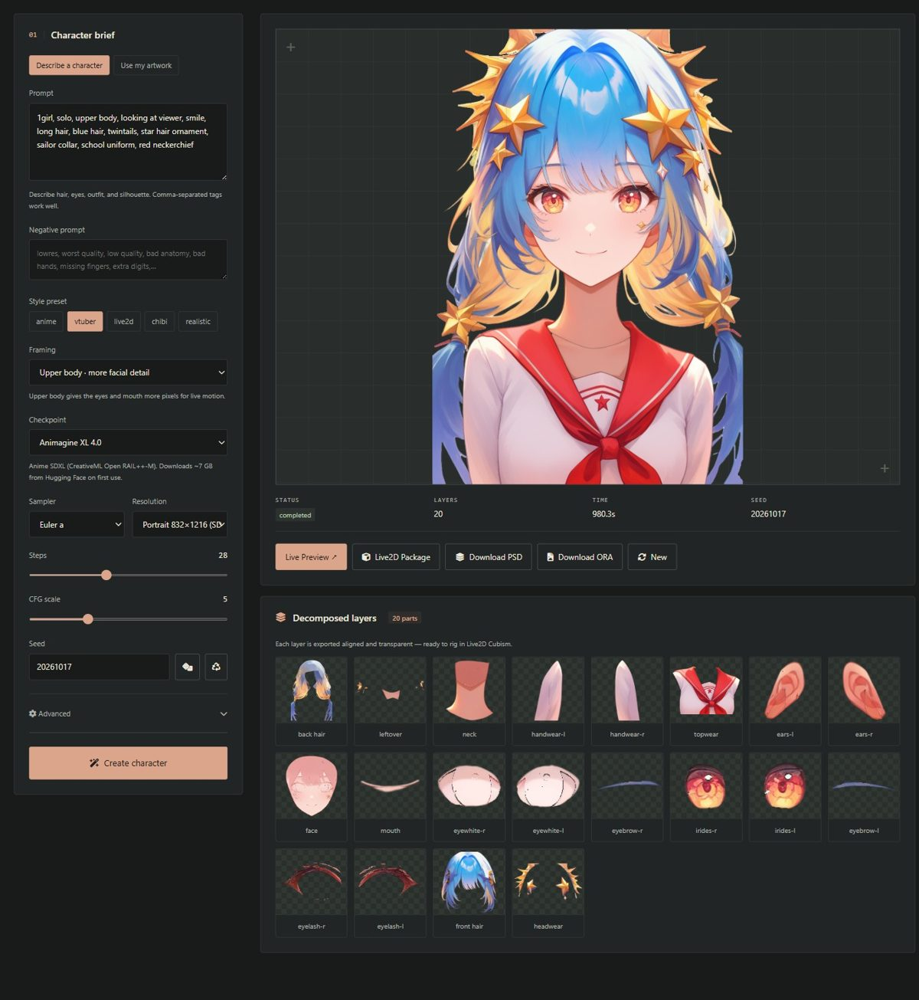
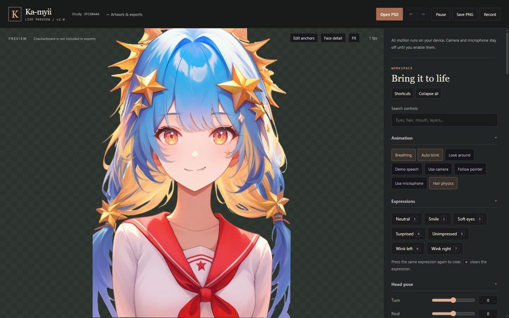

# Ka-myii

**Type a character brief, get a layered, rig-ready VTuber model, all on your own PC.**

Ka-myii is a local web studio that turns a prompt into an anime character, splits it into
20+ clean, named, transparent parts with [See-through](https://github.com/shitagaki-lab/see-through)
(SIGGRAPH 2026), lets you watch it blink, talk and follow your webcam in the browser, and
packages everything for Live2D Cubism: a layered PSD, an OpenRaster file and a Cubism project
scaffold.



```
brief ──► SDXL artwork ──► See-through layers ──► Live Preview ──► PSD / ORA + Cubism scaffold
          (~1–2 min)        (~10 min, 8 GB GPU)    (webcam, blink)   (finish rigging in Cubism 5)
```

## Highlights

- **Runs on an 8 GB laptop GPU.** See-through's 4-bit weights with block swapping peak at about
  4.6 GB. A character takes about 11 minutes on an RTX 4070 Laptop.
- **Real layer decomposition.** Front and back hair, face, eye whites, irises, lashes and
  brows (left and right), ears, nose, mouth, neck, clothing, accessories. Hidden areas are
  genuinely inpainted, so hair can move without leaving holes. Ka-myii also corrects
  See-through's draw-order mistakes, trims over-extended parts to what the artwork actually
  shows, drops hallucinated layers and keeps any unclaimed pixels in a `leftover` layer.
- **Live Preview.** WebGL animation with breathing, auto-blink, expressions and hair physics,
  plus optional webcam face tracking and microphone lip sync. Camera and audio never leave
  the browser.
- **A Studio that feels like a WebUI.** Your own SDXL checkpoints and LoRAs, sampler, CFG,
  seed and clip skip. Prompts longer than 77 tokens are encoded in chunks, not cut off.
  Danbooru tag autocomplete suggests 57k tags, most-used first.
- **Sketch first.** Generate artwork alone in about a minute, queue a few, then separate
  the layers of the one you like.
- **Bring your own design.** Import a character from Perchance, ChatGPT, an artist or your own
  sketchbook. Ka-myii finds the figure, frames it, replaces the scenery with white, can clean up
  small or JPEG-soft images, and writes a tag brief for it. Box one view on a reference sheet.
- **Edit and extend.** Repaint a region (hair, face, eyes, mouth, top, bottom, accessories, or
  anything you brush over) from a prompt, or retry it with a new seed. A character cut off by
  the picture border can be extended to full body, or just given room where it was cropped.
- **Blink and talk from the character's own art.** Closed eyes and the other mouth shape are
  painted for each character, so the Live Preview blinks and talks in the artwork's style.
- **Exports that work today.** A PNGtuber pack (idle / talk / blink PNGs for veadotube mini,
  PNGTuber Plus or Discord overlays), the layered PSD and ORA, and a Cubism starter project.
- **Save and reopen.** Every character can be exported as one zip and opened again in the
  Gallery, here or on another machine. Live Preview adjustments are saved with the character.
- **Background queue.** Line up several characters, reload or close the tab and come back.
  Cancel works at any stage, and unfinished jobs resume after a restart.
- **Demo mode.** The whole pipeline (layers, PSD, Cubism files, Live Preview) runs on a
  procedurally drawn character with no GPU and no downloads.



## Requirements

| | Real generation | Demo mode |
|---|---|---|
| GPU | NVIDIA, **8 GB+ VRAM** (CUDA 12.8 driver) | none |
| RAM | 16 GB | 4 GB |
| Disk | ~25 GB (PyTorch ~5 GB, Animagine XL 4.0 ~7 GB, See-through ~9 GB) | ~1 GB |
| Python | 3.10 – 3.13 (3.12 recommended) | same |

Tested on Windows 11 with an RTX 4070 Laptop (8 GB VRAM, 16 GB RAM). On Linux, `run.sh` has
been tested on Ubuntu 24.04 (WSL) in demo mode; real generation there should work but hasn't
been tested yet. macOS has no CUDA, so it supports demo mode only.

## Quick start

### Windows

1. Install [Python 3.12](https://www.python.org/downloads/) and tick **Add python.exe to PATH**.
   Newer Pythons can stay installed; the launcher picks a supported one through the `py` launcher.
2. Download or `git clone` this repository and double-click **`run.bat`**.

On first run it creates `.venv`, installs PyTorch (with CUDA if an NVIDIA GPU is present) and
the other dependencies, offers to install See-through (recommended, ~9 GB), then asks for
**1) Studio** or **2) Demo** and opens <http://127.0.0.1:5000/generator> in your browser.
Later runs start in seconds; dependencies are reinstalled only when `requirements.txt`
changes. Keep the console window open while you work; closing it stops the server.

### Linux

```bash
./run.sh
```

On Debian/Ubuntu, install venv support first if needed: `sudo apt install python3.12-venv`
(`run.sh` tells you when it's missing).

### Manual setup

```bash
python -m venv .venv
.venv\Scripts\activate          # Linux: source .venv/bin/activate
# NVIDIA on Windows: the CUDA build of PyTorch first
pip install torch==2.8.0+cu128 torchvision==0.23.0+cu128 --index-url https://download.pytorch.org/whl/cu128
pip install -r requirements.txt
python scripts/install_seethrough.py   # optional but recommended
python app.py --open                   # or: python app.py --dummy --open
```

## Using the Studio

1. **Write a brief.** Danbooru-style tags work best (`1girl, silver hair, twin braids,
   witch hat, gentle smile`). Autocomplete suggests real tags as you type; Tab or Enter accepts.
2. **Framing.** *Upper body* (the default) gives the eyes and mouth more pixels, which makes
   the live animation look much better. *Full body* shows the complete outfit.
3. **Checkpoint.** The default, **Animagine XL 4.0**, downloads automatically on first use
   (~7 GB, once). Any SDXL checkpoint you drop into `models/checkpoints/` appears in the list
   and is selected by default. Illustrious- and NoobAI-based (eps) anime models work well.
   LoRAs go in `models/loras/`.
4. **Create.** Progress shows each of the three steps with an estimate, also in the tab title.
   While a job runs, the button becomes **Add to queue**. **Sketch artwork only** stops after
   the artwork (about a minute); use **Separate layers** on the result, or in the Gallery,
   when you find one you like. It keeps the sketch's brief and seed.
   To use an existing design instead, choose **Use my artwork** and pick a PNG, JPG or WebP
   (see *Importing a design* below).
5. **Use the result.** Inspect the layers, open **Live Preview**, or download the **PNGtuber
   pack**, **Live2D package**, **PSD** or **ORA**. Everything is saved under `outputs/<id>/`
   and listed in the **Gallery**, where a character can be reopened with its exact settings and
   seed, renamed, exported as a zip or deleted. **Open exported character** brings a zip back.

### Importing a design

Pick the image and, if it shows several characters or views, drag a box around the one you
want. The import first makes a *prepared sketch* (seconds): the figure framed in an SDXL
portrait, scenery replaced with white (both optional), and a tag brief from the WD tagger.
**Clean up with AI** lightly redraws small, blurry or JPEG images (about a minute). Check the
sketch, edit or extend it if needed, then **Separate layers**. One character facing the viewer
works best; side and back views decompose poorly.

### Editing and extending

**Edit a region** under a sketch or result: pick parts and/or paint over an area, describe what
should be there (*short blue hair*, *red kimono*) or leave it empty to redraw the selection as it
is, and **Repaint selection**. **Try again** repaints with a new seed. **Complete cut-off edges**
adds room where artwork touches the border (for example a cropped hat). These edits create a
new sketch; your original stays in the Gallery.

To add missing arms, legs and outfit, click **Full body ↗** in Live Preview, or **Complete body**
beside the Studio result. The separate **Complete the body** panel accepts optional outfit details.
Choose **Full model + Live Preview** to draw, separate and prepare the result in one queued job,
or **Artwork to review first** for a faster sketch with a **Separate layers** action afterwards.
**Proportions** offers Balanced, Tall and Compact silhouettes. The head is measured from crown
to chin, including substantial hair rather than only the visible face. The neck sets the standing
axis. **Preview the fit before generating** shows the retained artwork, head-size ruler and the
shoulder/hip/ankle guide. Drag the shoulder, hip or ankle dots to set the stance (each pair
mirrors, so shoulders and hips stay level); **Reset stance** goes back to the measured one.
Large hats get more headroom; feet have space below the ankle targets.
**Preserve the face** retains a coherent head while the neck, collar and outfit are redrawn from
the jaw down into one body (so no old collar or shading is left floating). The body is sized from
the face width, as in the checkpoint's own full bodies (a head is about 1.33 face widths), so
voluminous hair cannot make the face small; a check flags a head that still looks too big or
too small for the body.

After a full body is drawn, **automatic checks** look for a second face (the tagger, run on
tiles down the body), shoes or a hat cut off by the border, and an uneven shoulder line (hair
is ignored), and each finding offers a fix: **Try another seed**, **Make room** or **Repaint
this area**. When the full body is separated into layers, the original character's eyes,
eyebrows, nose and mouth layers (separated at its larger size) replace the re-separated ones
wherever the new picture still shows them, and its painted blink/talk/toggle layers come along.

**Refine hands** / **Refine face** (in Edit a region) redraws each hand, or the face, in its own
close-up at SDXL's native resolution and pastes it back: a new sketch, about 30 s per part.
Hands are found from separated layers or a full body's pose guide.

**Align shoulders, hips and legs** uses a local SDXL pose model (first use: ~2.5 GB download).
It gives the extension a structural guide tied to the retained head, reducing doubled heads and
misaligned shoulders. FP8 weight storage with FP16 computation, early text-encoder release,
CPU offload and tiled decoding keep this path suitable for the 8 GB laptop. The original checkpoint
file is never modified; the models are unloaded afterwards. Turn alignment off for SD 1.5 or
unguided experiments; dramatic unguided extensions can drift. All extensions create new characters
and preserve the source. See [quality notes and next steps](docs/OUTPUT_QUALITY.md).
Demo mode demonstrates the workflow with placeholder artwork; detailed completion needs real mode.

### Blink and talk

Characters separated by See-through get painted closed eyes and a second mouth shape (open if
the artwork's mouth is closed, and the other way round), about two minutes after the layers.
Older characters get them with **Add blink & talk** in the Gallery. They drive the Live Preview's
blink and lip sync and the PNGtuber pack, and are hidden layers in the PSD for Cubism.

**A I U E O mouths** (a toggle chip in the Studio brief, or Paint toggles in Live Preview) are
five painted vowel shapes, about a minute. With the microphone, the vowel you say picks the
mouth: linear prediction finds the first two formants of each ~40 ms frame and compares them
with Japanese vowel formants scaled to your voice's pitch (no training). Auto talk picks vowels
at random and the camera uses the mouth's width; without them the mouth keeps its painted A.

### Expression toggles

Pick **Expression toggles** in the Studio brief (Blush, Tears, Sweat drop, Anger vein, Heart eyes,
Star eyes, > < eyes, Spiral eyes, Gloom, Sparkle aura, Question mark, Exclamation, Zzz, Music
notes, Floating hearts, Tongue out, Cat mouth, Fang) and they are painted in the character's own
style after its layers, about 15 s each (symbols such as the sweat drop, anger vein, ?, !, Zzz,
notes and hearts are drawn locally, need no GPU and bob gently with Idle). Mouth emotes stand in
for the talking mouth while on. For an existing character use **Paint toggles** under Expressions in
Live Preview. Each appears there as an on/off button (**Shift+1–9** as hotkeys; OBS follows) and
as a hidden `toggle …` layer in the PSD/ORA. Any PSD layer named `toggle <name>` becomes a toggle.

**Alternate look** (in the same panel) repaints the hair, top, bottom or headwear from a short
description (*short black bob*, *red hoodie*) and switches like a toggle, hiding the part it
replaces. It is painted over the character with that part taken away: See-through's other layers
are complete underneath, so a shoulder under shorter hair is the real layer, and what nothing
covered is drawn. One alternate per part is shown at a time.

### Live Preview

Breathing, blinking and gentle hair physics start immediately. **Face detail** zooms in on the
face. There are sliders for expressions, head and eyes, anchor adjustment, layer visibility and
order, transparent PNG snapshots and short recordings. **Use camera** and **Use microphone**
ask for permission only when clicked, and all processing stays in the browser (Chrome or Edge
with WebGL recommended; the camera needs `localhost` or HTTPS). **Save adjustments** keeps
sliders, layers and anchors with the character (they travel with its export zip). Preview
adjustments affect the browser preview only; they don't rig the Cubism project.

**Body & physics** has Gentle, Lively and Bouncy motion presets, plus a Bounce control.
**Natural sway** adds slower weight transfers with a pause at each end. **Weight shift** sets
how far the hips move over planted feet; **Breathing depth** controls a slower inhale/exhale.
Camera mode follows the tracked head instead of adding the idle weight-transfer loop.
**Springy nod** adds a quicker head-led dip and rebound, quieter shoulders and a little
head compression, with **Nod depth** and **Nod speed** controls. Depth 0 disables it; the other
motion presets also return to the regular idle style. With camera tracking, your own nod drives
the head rather than a repeating animation. Hair tips lag vertically as well as sideways, with
the shading beneath the bangs following the same motion.
Head tilt reaches about 16° (the **Tilt** slider, idle motion, or your own tilt about 1:1 on
camera). The head rolls on the neck, the neck bends from the jaw down to still shoulders,
a choker follows the neck, and long hair slides with the head. The **Neck pivot** anchor sets
where the bend starts; the shirt collar bends with the neck. **Head sway** tilts side to side at
half the nod speed (combine it with Springy nod for a dance-like bob). **Shoulder shrug** lifts
the shoulders and arms. **Body motion** adds a visible torso arc and shoulder roll; the body
follows the head with a short spring delay while the hips and feet stay planted. **Body turn**
and **Body tilt** also set manual poses. The head, collar, clothing and arms share the torso motion. Hats, bows and
ribbons trail the head and settle with Physics on (**Accessory sway** sets how much).
**Toothy smile**, **Surprised** and **Jaw dropped** provide teeth and rounded O shapes on older
characters too. **Mouth** has Show teeth, Rounded shape, Jaw drop and a gradual blend through
small speech openings; try **Demo speech** without enabling a device. Choose **Original only**
under Mouth artwork to use just the character's painted mouths. The extra shapes are preview
artwork included in PNG snapshots and recordings; artist PSD/ORA/Cubism exports stay unchanged.
The torso design follows [Live2D's motion guidance](https://docs.live2d.com/en/cubism-editor-tutorials/motion-hint/);
[implementation notes](docs/MOTION_NOTES.md) describe the approach and limits.

**Nekomimi & tail** fits optional animated cat ears and a swishing cat tail to existing models.
Choose a hair-matched or preset fur colour, adjust the ear spacing/height and tail position/size,
and choose either tail side. **Idle motion** adds ear twitches and swishing; **Physics** adds
follow-through on turns. Save adjustments to keep the fit. These additions appear in preview
PNG snapshots and recordings, with transparent padding where needed. They are preview artwork;
the original layered PSD, ORA, PNGtuber pack and Cubism package keep the character's original parts.
Separately named `cat ears` / `nekomimi` PSD layers also get ear motion; ordinary human `ears`
stay rigid.


**Paint toggles** can also add **Gloom** and **Sparkle aura**. These original manga overlays,
like Sweat drop and Anger vein, are drawn locally without diffusion. Sparkles gently float and
pulse with Idle. Heart, Star and Spiral eyes follow each eyelid independently during a blink;
> < eyes replace the ordinary eye states. Eye designs are mutually exclusive while cheek and
symbol emotes can combine. Toggles save with the character and export as hidden artist layers.

### Finishing in Live2D Cubism

Each character's `model/<name>/` folder (the **Live2D package** download) contains:

- `<name>.psd` / `.ora`: the layered artwork, back to front, named for Cubism.
- `<name>.model3.json`, `.cdi3.json` (the standard parameter set: `ParamAngleX/Y/Z`,
  `ParamEyeLOpen`, `ParamMouthOpenY`, ...), `.physics3.json` (starter hair and cloth physics)
  and an idle motion.
- `RIGGING_GUIDE.md`, a step-by-step walkthrough for the specific character.

The JSON files validate against the schemas in Live2D's
[CubismSpecs](https://github.com/Live2D/CubismSpecs). The physics drives the standard
`ParamHairFront` / `ParamHairBack` (plus declared sway parameters for accessories and skirts).

Open the PSD in **Cubism 5**, run *Modeling → Deformer → Auto Generation of Deformer* (5.1+)
and *Auto generation of facial motion* from the Parameters palette (5.0+), then export for
runtime. The binary `.moc3` can only be produced by the Cubism Editor, so Ka-myii prepares
everything up to that step.

### Training a look LoRA

`scripts/build_lora_dataset.py` builds a training set of *rig-ready* character art: it generates
varied designs with the default checkpoint and keeps only the ones the pipeline handles best (one
character facing the viewer, head not cut off, eyes and mouth clear, hands down, plain white
background), checked with the same segmentation and tagger Ka-myii uses. Captions start with the
trigger `kmyvt`. Add your own art with `--extra <folder>` (only art you may train on).

```bash
python scripts/build_lora_dataset.py --out datasets/vtmodel --count 320   # ~4-5 h on an 8 GB laptop GPU
```

Train it with `scripts/train_lora.py` (SDXL LoRA, fits 8 GB; prints a progress bar and a summary
per epoch, logs `training_log.csv`, `--resume` after an interruption, installs the result in
`models/loras/`), or any SDXL LoRA trainer that reads image + same-name `.txt` pairs (the zip in
`datasets/`). Pick the LoRA in the Studio and start prompts with `kmyvt`.

```bash
python scripts/train_lora.py --dataset datasets/vtmodel.zip --epochs 12
```

## How decomposition works

Ka-myii picks the best available backend:

1. **See-through** (recommended). A layer-diffusion model generates every semantic part as
   its own RGBA layer, including the parts hidden behind hair and clothes, and a depth model
   orders them. Ka-myii runs it in its own virtualenv as a separate process (so its GPU memory
   is fully released after each job), then:
   - cuts the character out with an anime segmentation model;
   - fixes draw orders that depth gets wrong for thin parts (iris under eye white, bangs under
     the face);
   - gives every visible pixel to the part the artwork really shows there, trimming
     over-extended predictions;
   - drops hallucinated layers and empty accessory specks;
   - keeps the artist's visible colours;
   - puts character pixels no layer claimed (cat ears, a witch hat) into a `leftover` layer
     so nothing goes missing.
2. **SAM 2**, if `sam2` is installed and `KAMYII_SAM2_CHECKPOINT` is set: automatic masks
   classified into semantic layers.
3. **Geometric fallback**: a rough anatomical split of the cut-out character.

Demo mode uses the procedural character's own pixel-perfect region map.

After an update, `python scripts/rebuild_layers.py <model_id>` re-applies the latest
post-processing to an existing result from its saved See-through PSD, with no GPU needed.

## Configuration

Every setting has a sensible default. To change one, copy `.env.example` to `.env`.
Common ones:

| Variable | Default | |
|---|---|---|
| `PORT` | `5000` | |
| `HOST` | `127.0.0.1` | `0.0.0.0` exposes the studio to your network, **without any login** |
| `KAMYII_MODEL_NAME` | `cagliostrolab/animagine-xl-4.0` | default Hugging Face checkpoint |
| `KAMYII_SEETHROUGH_RESOLUTION` | `1024` | `1280` gives sharper layers on 12 GB+ GPUs |
| `KAMYII_CPU_OFFLOAD` | auto below 12 GB | lower VRAM use for SDXL, slightly slower |

## Troubleshooting

- **`run.bat` says Python 3.10 to 3.13 is needed.** PyTorch's CUDA 12.8 build doesn't
  support newer Pythons yet. Install 3.12 alongside your current one; `run.bat` finds it.
- **The window closes immediately.** Open a terminal in the folder and run `run.bat` there
  to read the error.
- **"CUDA available: False" or very slow generation.** Update the NVIDIA driver, delete
  `.venv` and run `run.bat` again so it reinstalls the CUDA build of PyTorch.
- **The first character sits on "Downloading ...".** The default checkpoint is ~7 GB and
  downloads once. See-through's weights are fetched by its installer.
- **A job fails with out-of-memory, or is extremely slow.** Close other GPU-heavy apps.
  On 8 GB, keep See-through at resolution 1024. Above ~7.7 GB of VRAM use, NVIDIA drivers
  silently spill into system RAM and run ~10× slower.
- **The camera doesn't start in Live Preview.** Use Chrome or Edge on `http://127.0.0.1:5000`
  (not a LAN IP) and allow camera access.
- **Port 5000 is busy.** `python app.py --port 5001`, or set `PORT` in `.env`.

Logs are written to `logs/kamyii.log`.

## Status and known limitations

Ka-myii is an early release. What works and has been checked on real hardware: generation, See-through
decomposition, Live Preview, the queue, uploads, and the PSD/ORA/Cubism files (validated against
Live2D's published JSON schemas). Not yet confirmed by a human:

- importing a package into the Live2D Cubism Editor and running its auto-generation tools;
- webcam tracking and lip sync with a physical camera and microphone (both were verified in
  Edge with synthetic devices: face found, head tilt followed live, mouth moved with audio);
- real (GPU) generation on Linux.

Layer quality depends on the artwork. Front-facing upper-body characters on plain backgrounds
decompose best; arms, hands and complex poses are weaker, and parts See-through cannot name end up
in `leftover` / `headwear`. Issues with example images are very welcome.

## Privacy and security

Everything runs locally; nothing is uploaded and there is no telemetry. Internet is needed
only to download dependencies and model weights. The server listens on `127.0.0.1` and
rejects requests from other sites. It has no accounts or authentication, so don't expose it
to the internet.

## Development

```bash
python -m pytest tests -q            # GPU-free; demo mode + monkeypatched See-through
node tests/preview_runtime.test.cjs  # browser-runtime checks (optional)
node tests/tagcomplete.test.cjs
```

`tests/e2e` drives the real UI in a browser against a demo-mode server (create → Live Preview →
saved adjustments; import → crop → region edit → separate; Gallery export → reopen → delete).
It needs `pip install playwright` and `python -m playwright install chromium`, or an installed
Edge/Chrome via `KAMYII_E2E_CHANNEL=msedge`; without a browser it is skipped.

```
app.py                       Flask entry point
config.py                    settings (.env overrides)
src/api/generation.py        REST API: /generate (queues a job), /jobs, layers, artifacts
src/pipeline/jobs.py         background job queue (one GPU job at a time, cancel, progress)
src/pipeline/assembly_line.py  generate → separate → package
src/core/image_generator.py  SDXL via diffusers (chunked prompts, LoRAs, samplers) + demo renderer
src/core/asset_separator.py  layer decomposition and See-through post-processing
src/core/seethrough.py       runs See-through in its own venv as a subprocess
src/core/psd_exporter.py     layered PSD / ORA
src/core/model_assembler.py  Cubism scaffold (model3 / cdi3 / physics3, guide)
src/core/live_preview.py     preview PSD for the browser rig
src/core/importer.py         imported designs: framing, white background, clean-up
src/core/tagger.py           WD tagger: tag briefs for imports, edits and expressions
src/core/regions.py, outpaint.py  region selections and canvas extension for SDXL inpainting
src/core/expressions.py      painted closed eyes and second mouth shape
src/core/pngtuber.py, project.py  PNGtuber pack; reopening exported characters
scripts/                     See-through installer and runner, rebuild_layers.py
templates/, static/          Studio, Gallery and Live Preview
```

`AGENTS.md` holds the detailed engineering notes: architecture, hard-won facts and the backlog.

## Credits

- [See-through](https://github.com/shitagaki-lab/see-through): Lin et al., SIGGRAPH 2026,
  Apache-2.0. Downloaded by `scripts/install_seethrough.py` at a pinned commit, not vendored.
- [Animagine XL 4.0](https://huggingface.co/cagliostrolab/animagine-xl-4.0): Cagliostro
  Research Lab, CreativeML Open RAIL++-M. Downloaded on first use.
- [WD ViT Tagger v3](https://huggingface.co/SmilingWolf/wd-vit-tagger-v3): SmilingWolf,
  Apache-2.0, run with ONNX Runtime. Downloaded on first use.
- [anime-segmentation](https://github.com/SkyTNT/anime-segmentation) IS-Net weights
  (`skytnt/anime-seg`): SkyTNT, Apache-2.0, run with [ONNX Runtime](https://onnxruntime.ai) (MIT).
- [Anime2.5DRig](https://github.com/852wa/Anime2.5DRig): 852wa, MIT. It is vendored with
  local changes in `static/vendor/anime25d` (see `UPSTREAM.md`) and bundles
  [ag-psd](https://github.com/Agamnentzar/ag-psd) (MIT) and MediaPipe FaceMesh (Apache-2.0).
- Danbooru tag list from [a1111-sd-webui-tagcomplete](https://github.com/DominikDoom/a1111-sd-webui-tagcomplete),
  Dominik Reh, MIT.
- Bootstrap 5.3 and Axios (MIT); Font Awesome Free 6.4 (icons CC BY 4.0, fonts SIL OFL 1.1).
  The licenses are in `static/vendor/`.

Generated images are subject to the license of the checkpoint you use.

## License

MIT; see [LICENSE](LICENSE). Third-party components keep their own licenses (above).

Pose-guided extension uses [xinsir/controlnet-openpose-sdxl-1.0](https://huggingface.co/xinsir/controlnet-openpose-sdxl-1.0),
Apache-2.0, pinned to `23f966cd5cfdd3f7729c903e243d87152162d2b7`.
Weights are downloaded to the Hugging Face cache, not bundled or committed. Pose-guide artwork
and manga overlays are generated by Ka-myii's own code. Live2D/creator reference videos are used
for study only; their artwork and animation files are not redistributed.
